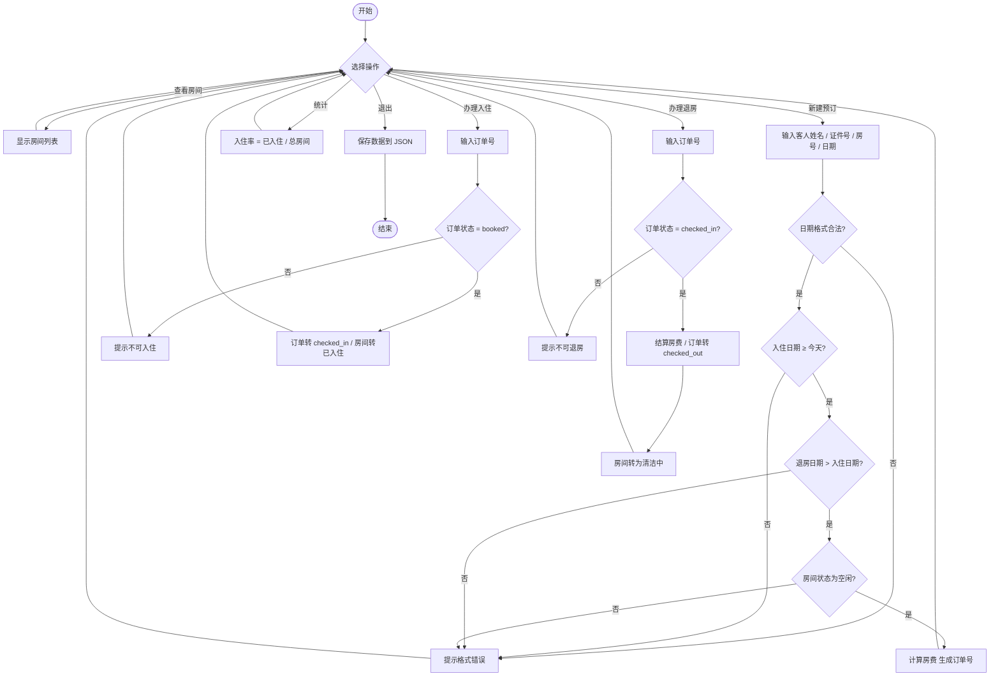
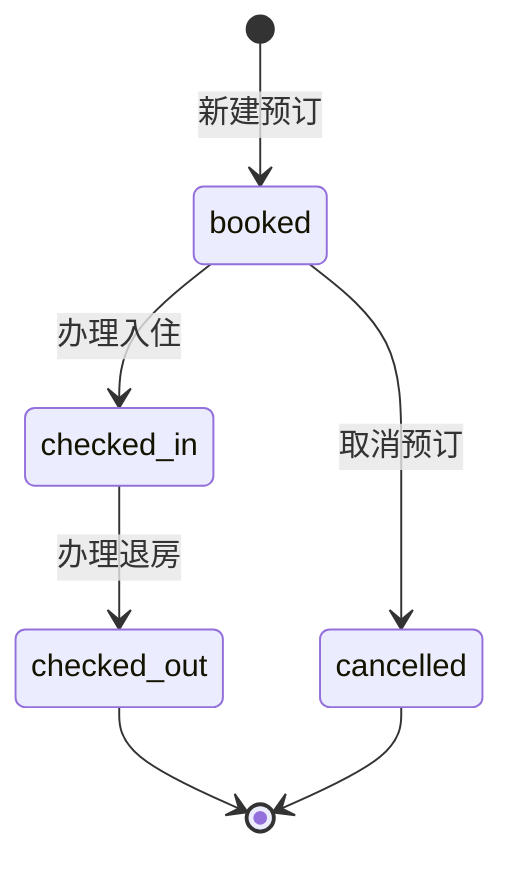
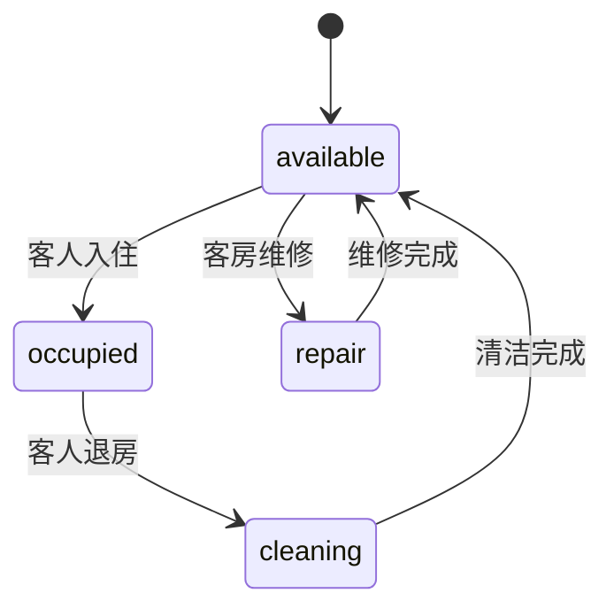

# Hotel Management System（酒店管理系统）
#Jay-project
> Senior Capstone Project — Python 单人项目  
> 作者：Capstone Project Student ｜ 日期：2026-11-11

---

## 1. 项目简介

这是一个基于 Python 的酒店管理系统，用于管理酒店日常核心业务：房间状态、客人登记、预订、入住、退房结算与入住率统计。

项目采用**单文件、零第三方依赖**的实现方式，使用 Python 标准库完成全部逻辑，数据以 JSON 文件本地持久化，便于课程演示与后续扩展。

---

## 2. 开题四问（Project Brief）

### Q1. Give me an update on your project idea?

My capstone project is a hotel management system. I plan to use Python as the main programming language, with HTML and JavaScript as an optional simple web interface in later stages, Mermaid to draw workflow diagrams, and LaTeX to write the pricing and occupancy calculation formulas. The basic idea and technology stack have been confirmed.

### Q2. What is the scope of your project idea for class 10?

This project focuses on basic hotel management functions: room status management, guest registration, booking records, and check-in / check-out operations. It includes a clear README, flow charts, and simple calculation formulas. It will **not** include complex financial analysis, a large database, or advanced marketing modules.

### Q3. What you want accomplished in week 3, in your project?

By week 3, I will finish the full project outline, complete the first version of the README document, draw the Mermaid business flow chart, and test the first simple Python module for room information management.

### Q4. How will you complete it?

I will write the core functions in Python step by step. I will use Markdown to maintain the README, Mermaid to draw flow diagrams, and LaTeX for pricing and occupancy calculation formulas. Each function is tested separately, and bugs are fixed continuously.

---

## 3. 功能清单

| 编号 | 功能 | 说明 |
|------|------|------|
| 1 | 查看全部房间 | 显示房号、房型、单价、当前状态 |
| 2 | 查看空闲房间 | 只列出可预订房间 |
| 3 | 新建预订 | 登记客人信息，校验日期与房间可用性，自动计算房费 |
| 4 | 办理入住 | 订单状态 → 已入住，房间状态 → 已入住 |
| 5 | 办理退房 | 结算房费，房间状态 → 清洁中 |
| 6 | 取消预订 | 仅允许取消未入住订单 |
| 7 | 查询客人订单 | 按客人姓名关键字模糊查询 |
| 8 | 查看所有订单 | 支持按状态筛选 |
| 9 | 修改房间状态 | 空闲 / 清洁中 / 维修中 |
| 10 | 入住率统计 | 已入住房间数 ÷ 总房间数 |
| s | 保存数据 | 写入 `hotel_data.json` |
| 0 | 退出 | 自动保存后退出 |

---

## 4. 房型与价格

| 房型 | 英文标识 | 房号范围 | 单价 |
|------|----------|----------|------|
| 标准单人间 | `single` | 001 – 008 | ¥268 / 晚 |
| 标准双人间 | `double` | 009 – 017 | ¥398 / 晚 |
| 豪华套房 | `suite` | 018 – 020 | ¥688 / 晚 |

房费计算公式：

```
房费总额 = 入住晚数 × 房间单价
入住晚数 = 退房日期 - 入住日期
```

---

## 5. 业务流程



### 订单状态流转



### 房间状态流转



---

## 6. 运行方式

### 环境要求

- Python 3.7 及以上
- 无需安装任何第三方库

### 在 VS Code 中运行

1. 打开项目文件夹，选中 `hotel_management.py`
2. 点击右上角 **Run** 按钮，或在终端执行：

```bash
python hotel_management.py
```

3. 终端会显示菜单，输入编号即可操作。

### 快速演示模式（非交互）

不想手动输入时，直接运行内置演示流程：

```bash
python hotel_management.py demo
```

演示内容：查看房间 → 新建预订 → 办理入住 → 统计入住率 → 再建一笔预订 → 查询订单 → 办理退房 → 再次统计 → 输出全部订单。

---

## 7. 目录结构

```
项目根目录/
├── hotel_management.py     # 主程序（单文件，包含全部逻辑）
├── hotel_data.json         # 运行时自动生成的数据文件
└── README.md               # 本文档
```

> `hotel_data.json` 首次运行后自动创建，用于保存房间状态与订单记录，删除后程序会重新初始化 20 个房间。

---

## 8. 核心代码结构

| 类 / 函数 | 职责 |
|-----------|------|
| `Room` | 房间对象：房号、房型、状态、单价 |
| `Booking` | 订单对象：订单号、客人信息、日期、房费、状态 |
| `Hotel` | 核心业务逻辑：房间管理、预订、入住、退房、统计、持久化 |
| `Hotel.show_rooms()` | 房间列表展示 |
| `Hotel.create_booking()` | 预订创建与全部合法性校验 |
| `Hotel.check_in()` / `Hotel.check_out()` | 入住 / 退房状态流转 |
| `Hotel.occupancy_rate()` | 入住率计算 |
| `Hotel.save()` / `Hotel.load()` | JSON 数据存取 |
| `menu()` | 终端交互菜单 |
| `demo()` | 非交互演示流程 |

---

## 9. 数据格式示例

`hotel_data.json` 结构：

```json
{
  "hotel_name": "Sunrise Hotel",
  "rooms": [
    { "number": "001", "room_type": "single", "status": "available" }
  ],
  "bookings": [
    {
      "booking_id": 1001,
      "guest_name": "张三",
      "guest_id": "ID20260001",
      "room_number": "001",
      "check_in": "2026-11-11",
      "check_out": "2026-11-14",
      "total": 804,
      "status": "checked_in"
    }
  ]
}
```

---

## 10. 后续可扩展方向（Week 3 之后）

- [ ] 增加图形界面（Tkinter / Web 前端）
- [ ] 支持房间按日期区间冲突检测（同一房间多笔预订）
- [ ] 增加客人档案与历史入住记录
- [ ] 增加营收统计与月度报表导出
- [ ] 拆分为多模块结构（`models.py` / `hotel.py` / `main.py`）
- [ ] 补充单元测试（`unittest`）

---

## 11. 已知限制

- 当前仅支持单机运行，数据存于本地 JSON 文件，不支持多用户并发
- 不含数据库，数据量大时性能有限
- 预订冲突检测基于房间**当前状态**，尚未实现按日期区间的重叠判断
- 无权限体系与登录模块

---

*本文档随项目迭代持续更新。*
